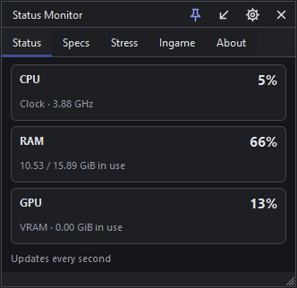
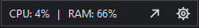
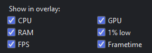
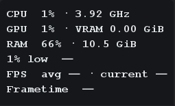

# Status Monitor
***
System monitor, metrics, games, and stress test.

by GMRicker

## Features
***
- **Status**:
  - CPU % usage and clock frequency.

- **Specs**:
  - System specifications such as O, Processor, Video Card, RAM, Motherboard, and Disk Drive.

- **Stress**:
  - Processor and graphics card stress test.

- **Game Metrics**:
  - Game performance monitoring.

## Compact Mode
***

## Ingame
***

